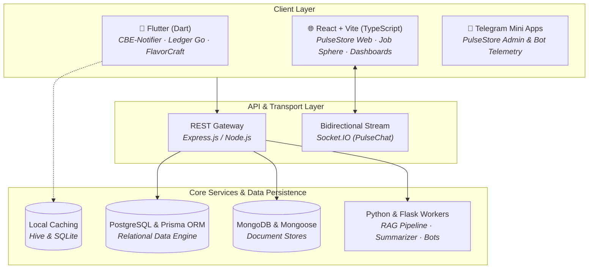

  # ⚡ Hi, I'm Kanzedin Akmel 👋
  ### Full-Stack & Mobile Software Engineer

  

    
    
    
    
  

  

    <b>Building production-ready cross-platform mobile apps, reactive web interfaces, and scalable micro-services.</b> 
    Specializing in <b>Flutter</b>, <b>React / TypeScript</b>, <b>Node.js / Express</b>, <b>PostgreSQL</b>, and <b>AI Integrations</b>.
  

  

    
  

---

### 🧩 System Architecture & Tech Ecosystem

---

### 🛠️ Core Technologies & Tooling

| Domain | Stack |
| :--- | :--- |
| **Mobile & Cross-Platform** |     |
| **Frontend Engineering** |      |
| **Backend & Realtime** |     |
| **Data Stores** |    |
| **AI, Automation & Scripting** |    |

---

### 🌟 Featured Flagship Projects

<table>
  <tr>
    <td width="50%" valign="top">
      <h3 align="center">📲 CBE-notifier</h3>
      
<b>Intelligent Offline Android Banking Alert Engine</b>

      
A privacy-first Android utility engineered to parse incoming Commercial Bank of Ethiopia (CBE) transaction messages locally. Converts incoming amounts into synthesized offline Amharic audio cues while aggregating offline accounting summaries without cloud reliance.

      

        
        
        
      

      <a href="https://github.com/Kanzu11/CBE-notifier"><b>View Source Code & Specs →</b></a>
    </td>
    <td width="50%" valign="top">
      <h3 align="center">🛍️ PulseStore</h3>
      
<b>Full-Stack E-Commerce & Telegram Mini App Ecosystem</b>

      
Production-grade commerce platform uniting a reactive web storefront with a Telegram Mini App administration console. Features instant bot-driven order dispatching, live telemetry, and relational transactional integrity backed by PostgreSQL and Prisma.

      

        
        
        
        
      

      <a href="https://github.com/Kanzu11/Puls-Store"><b>View Source Code & Specs →</b></a>
    </td>
  </tr>
  <tr>
    <td width="50%" valign="top">
      <h3 align="center">⚡ PulseChat</h3>
      
<b>Low-Latency Bidirectional WebSocket Chat Engine</b>

      
Scalable real-time messaging pipeline built on WebSockets. Delivers instant event distribution, dynamic presence tracking, typing heartbeat broadcasts, and multi-state delivery acknowledgment (sent, delivered, seen ticks).

      

        
        
        
      

      <a href="https://github.com/Kanzu11/Pulse-chat-web-socket-project-"><b>View Source Code & Specs →</b></a>
    </td>
    <td width="50%" valign="top">
      <h3 align="center">🧠 Knowledge AI Platform (CSE-DEV)</h3>
      
<b>RAG Document Parsing & Semantic Context Engine</b>

      
Full-stack AI assistant operating on a Retrieval-Augmented Generation (RAG) architecture. Handles unstructured file ingestion, vector chunking, and intelligent conversational retrieval powered by an Express backend and React dashboard.

      

        
        
        
      

      <a href="https://github.com/Kanzu11/CSE-DEV"><b>View Source Code & Specs →</b></a>
    </td>
  </tr>
</table>

---

### 📁 Curated Repositories

<b>📱 Mobile Engineering</b>

 

| Project | Primary Stack | Key Features & Architecture |
| :--- | :--- | :--- |
| **[CBE-notifier](https://github.com/Kanzu11/CBE-notifier)** | `Flutter` `Dart` | Local SMS regex ingestion, Amharic TTS playback, fully offline analytics. |
| **[Expense-tracker-](https://github.com/Kanzu11/Expense-tracker-)** | `Flutter` `Dart` | **Ledger Go**: Category-based budget ceilings, visual charts, custom widgets. |
| **[Recipe-mobile-app](https://github.com/Kanzu11/Recipe-mobile-app)** | `Flutter` `Hive` `Firebase` | **FlavorCraft**: Firebase Auth, FCM alerts, offline-first persistence with Hive. |

<b>🌐 Full-Stack & Web Engineering</b>

 

| Project | Primary Stack | Key Features & Architecture |
| :--- | :--- | :--- |
| **[PulseStore](https://github.com/Kanzu11/Puls-Store)** | `React` `TS` `Prisma` `PostgreSQL` | Multi-channel commerce platform with synchronized Telegram Mini App ops. |
| **[Pulse-chat](https://github.com/Kanzu11/Pulse-chat-web-socket-project-)** | `Socket.IO` `Express` `React` | Low-latency state sync, active user presence, read receipt triggers. |
| **[Library Management](https://github.com/Kanzu11/Library-Management-System-Frontend)** | `React` `Tailwind` `ShadCN` `Jotai` | Granular role-based access control, catalog management, atomic state store. |
| **[Job Sphere](https://github.com/Kanzu11/job-search)** | `React` `Vite` `Tailwind` | Advanced job query engine with multi-parameter filtering and responsive UI. |
| **[Developer Portfolio](https://github.com/Kanzu11/my-portfolio)** | `TypeScript` `Vite` | Personal engineering showcase, modern typography, optimized performance. |

<b>🤖 AI, Backend & Algorithms</b>

 

| Project | Primary Stack | Key Features & Architecture |
| :--- | :--- | :--- |
| **[CSE-DEV](https://github.com/Kanzu11/CSE-DEV)** | `Node.js` `Express` `MongoDB` | Retrieval-Augmented Generation (RAG) platform with context injection. |
| **[Briefly AI](https://github.com/Kanzu11/ai-text-summarize-bot)** | `Python` `Flask` `Telegram` | Multi-ratio abstractive text summarizer accessible via REST API and bot. |
| **[AI Code Reviewer](https://github.com/Kanzu11/ai-code-review-assignment)** | `Python` | Automated pull-request evaluation and code quality scanner. |
| **[Problem Solving & DSA](https://github.com/Kanzu11/leetcode)** | `Python` | High-efficiency solutions across LeetCode, HackerRank, and GeeksforGeeks. |

---

### 📊 GitHub Activity & Insights

  
  

   
  

---

  Designed & Developed by <b>Kanzedin Akmel</b> · Built for reliability, clean architecture, and scale.

